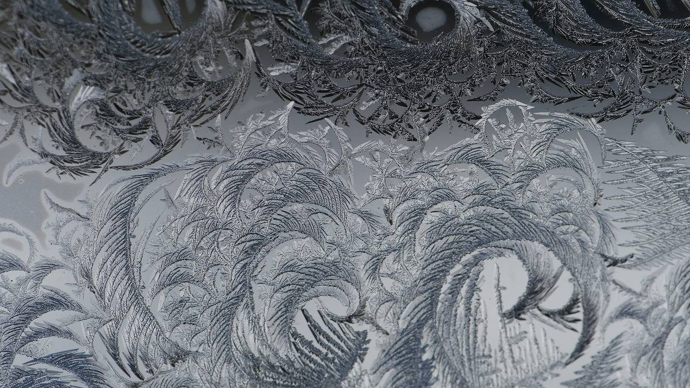

# Material parameter segmented constant quantitative photoacoustic tomography (Matlab code implementation)

Quantitative Optical Acoustic Tomography with Constant Material Parameter Sections (Matlab Code Implementation)

## Images

<!-- PAYMENT_BLOCK -->

## Get this dataset

- Payment link (Stripe): [Buy now](https://buy.stripe.com/3cs8yP7sY87d0vu9AB)
- Payment QR code: 

<!-- /PAYMENT_BLOCK -->
